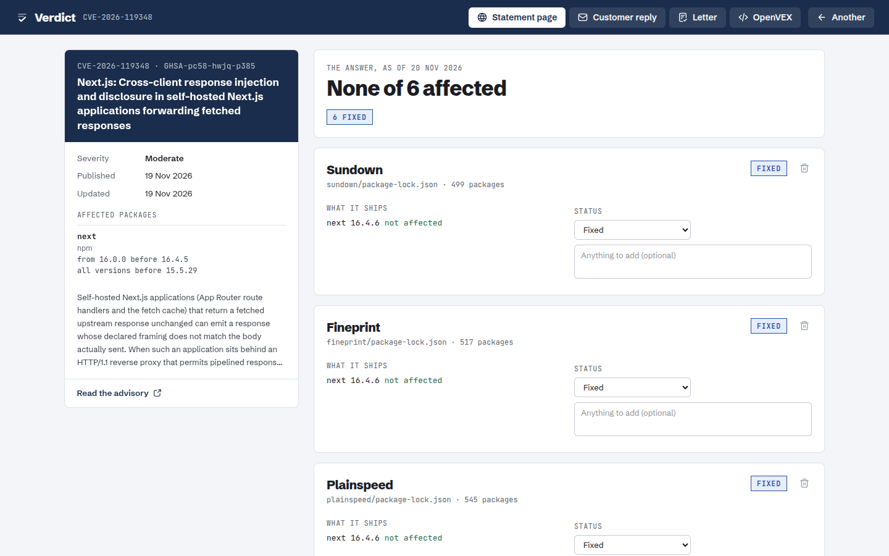
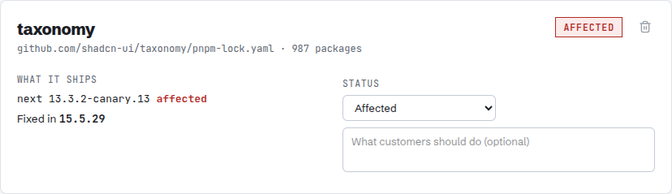
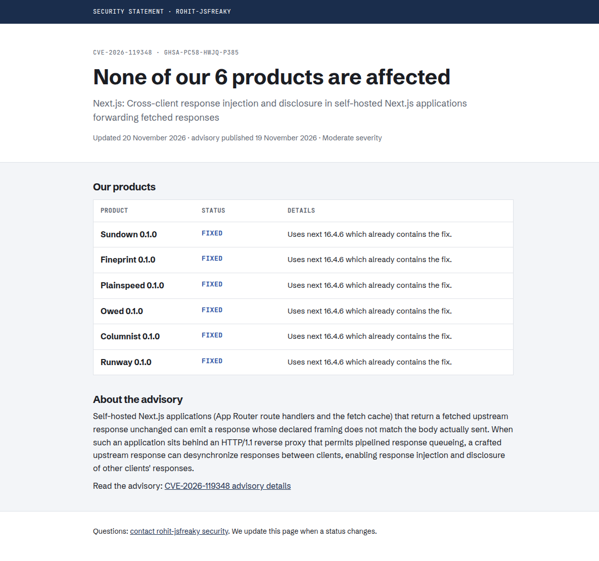
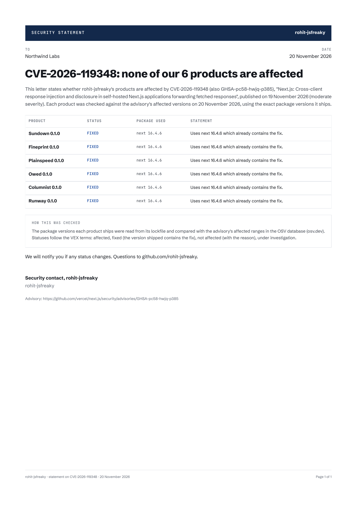

# Verdict

**"Are you affected?" Answered and published.** When a vulnerability makes news, every customer asks every vendor
the same question. Paste a CVE or GHSA id. Verdict reads the advisory from [OSV](https://osv.dev), checks each of
your products' lockfiles against it, gives each product a status, and writes:

- the security statement (a web page)
- the reply to customers (an email)
- a signed letter (PDF) for procurement and auditors
- an [OpenVEX](https://openvex.dev) file for security tools

Built with [Hyper Elements](https://github.com/hyper-elements/hyper-elements) for the Hyper Elements Template Challenge.

**Live:** https://verdict.rohitkashyapmrt.workers.dev



## Why this exists

When Log4Shell broke in December 2021, the Dutch national cyber security centre kept a public list of vendors'
answers ([NCSC-NL/log4shell](https://github.com/NCSC-NL/log4shell)), so customers wouldn't have to hunt for them
one by one. It grew to thousands of products, each with a status (*Vulnerable, Fix, Workaround, Not vuln,
Investigation*) and a link to the vendor's own statement. Every one of those statements had to be checked,
written, published, and repeated in customer inboxes.

**A real example.** On 19 November 2026 Next.js published
[CVE-2026-119348 / GHSA-pc58-hwjq-p385](https://github.com/vercel/next.js/security/advisories/GHSA-pc58-hwjq-p385),
"Cross-client response injection and disclosure in self-hosted Next.js applications forwarding fetched responses"
(moderate). It affects `>=16.0.0 <16.4.5` and everything before `15.5.29`. Checked on 20 November:

| Project | Ships | Status |
|---|---|---|
| The six apps in this series (Sundown, Fineprint, Plainspeed, Owed, Columnist, Runway) | next 16.4.6 | **Fixed** (16.4.6 contains the 16.4.5 fix) |
| [shadcn-ui/taxonomy](https://github.com/shadcn-ui/taxonomy) | next 13.3.2-canary.13 | **Affected**, fixed in 15.5.29 |
| [steven-tey/precedent](https://github.com/steven-tey/precedent) | next 14.3.0-canary.57 | **Affected**, fixed in 15.5.29 |



## How it works

| Step | What happens |
|---|---|
| **Look up** | Paste a CVE or GHSA id. Verdict reads it from OSV. A CVE id is followed to its GitHub advisory, which lists the affected packages and version ranges. |
| **Add products** | One lockfile per product: `package-lock.json` (v1-v3), `pnpm-lock.yaml` (v6, v9), `yarn.lock` (v1 and berry), or a CycloneDX JSON SBOM (Maven, PyPI, Go, RubyGems, crates.io, NuGet, Packagist…). Or a public GitHub repository. |
| **Decide** | Verdict asks OSV (`/v1/querybatch`) whether the exact versions each product ships are affected; OSV does the range matching, canaries included. Each product gets a status: *affected* (with the version to move to), *fixed* (the version shipped has the fix), *not affected* (with the reason), or *under investigation*. Change any of them by hand and add a note. |
| **Publish** | Preview and download the statement page, the customer reply and the letter, and download the OpenVEX file. |

The statuses and reasons are VEX's (Vulnerability Exploitability eXchange): the page a person reads and the file a
scanner reads say the same thing.

| Statement page | Letter |
|---|---|
|  |  |

The customer reply: [media/reply.png](media/reply.png). The landing page (7 sections with an FAQ):
[media/landing.png](media/landing.png). On a phone: [media/mobile.png](media/mobile.png).

## How Hyper Elements is used

The three documents are **Hyper Elements templates** in `templates/`, one per root. The app renders them in a
browser (`src/lib/render-route.ts`, so the site runs on Cloudflare with no render server), and the CLI renders the same files.

- **Typed fields with rules** (`templates/_shared/doc.tsx`): the advisory id must look like `CVE-…`/`GHSA-…`, the
  link must be `https://`, severity is a choice, and each product's status and reason are choices from the VEX
  vocabulary. A value outside the rules stops the render with the field and the reason; the API answers 422 with
  the diagnostics, and the app shows them.
- **`<Page>`** for the statement, with a theme and lint (`lang`, `contrast`, `link-text`). Lint flagged a real
  conflict while we built it: the theme's link colour overriding the footer's text colour.
- **`<Email>`** for the reply, with the email client checks and preview text required.
- **`<Document>` + `renderPdf()`** for the letter: header band, the product table, how it was checked, signature,
  `PageFooter` with `PageNumber`.
- **Values files + CLI:** `npm run statement` turns `docs/nextjs.json` into values files with `hyper-elements
  design new`, then renders all three with `hyper-elements render`.

## Run it

Needs Node 22.6+.

```bash
npm install
npm run dev            # http://localhost:3000 (landing) and /check (the dashboard)
```

```bash
npm test               # every lockfile format, the real advisory, verdicts, OpenVEX (6 tests)
npm run check          # check the three templates with their example
npm run statement      # docs/nextjs.json → out/docs/ (statement page, reply email, letter PDF)
npm run sample         # rebuild the sample from OSV and the series' lockfiles
npm run preview:email  # the email as each email client draws it
npm run build && npx wrangler dev   # the static site, served the way Cloudflare does
```

## Project layout

```
templates/_shared/vex.ts      lockfile and SBOM readers, OSV advisory reader, verdicts, OpenVEX, values (no imports)
templates/_shared/doc.tsx     fields, the bulletin look, the stamp
templates/_shared/example.ts  the sample: CVE-2026-119348 vs the series' six apps (generated by scripts/sample.ts)
templates/statement.tsx       <Page>: the security statement
templates/reply.tsx           <Email>: the reply to customers
templates/letter.tsx          <Document>: the signed letter
src/lib/sources.ts            OSV lookups, GitHub repos, uploads, the frozen sample
src/components/Desk.tsx       the dashboard: advisory, products, statuses, outputs
src/app/page.tsx              the landing page
public/samples/               the frozen sample (advisory records, the six apps' packages, OSV's answers)
tests/                        vex tests
```

## Sample data

`public/samples/our-apps-2026-11-20.json` holds the advisory as OSV returned it on 20 November 2026, the package
lists read from this series' own `package-lock.json` files, and OSV's answers for them. The statement is signed by
the series' author (rohit-jsfreaky); "Northwind Labs", the customer, is made up. taxonomy and precedent are read live
from their public repositories and appear only as examples of an affected project, never on a statement. Verdict is
not affiliated with Next.js, OSV, NCSC-NL or any project shown.

## License

MIT for the code. Fonts: Schibsted Grotesk and JetBrains Mono, SIL Open Font License 1.1 (`fonts/OFL-*.txt`).
